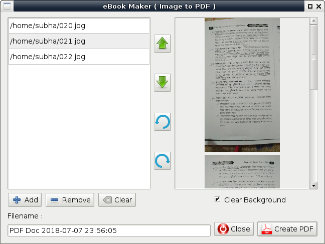

# eBook Maker
Images to PDF converter written in PyQt5  

### Dependencies
 * python3-pyqt5  
 * pyqt5-dev-tools

### Install
Open terminal and change to project root directory. Then run...  
`pip install --user --no-build-isolation .`  

### Uninstall
`pip uninstall ebook-maker`  

### How to Convert
To convert to PDF, select the images and right click in file manager and select _Open With..._ eBook Maker  

### Features
 * Rotate Pages  
 * Clean Background (unpaper)  
 * Reorder pages  
 * convert to monochrome  
 * save as pdf  

### Screenshot
  
